# Bandarchy Visualiser: 6-Layer Architecture & Generic Audio-Responder Reference

## 1. What is `layer4DualMix` (`Dual 2x Simultaneous Blending`)?

> [!NOTE]
> Even though it is now on button **`5: Vortex`** in the 6-Layer bar, its internal variable names in [Visualiser.qml](file:///home/matthew/Projects/bandarchy/Visualiser.qml) and [share/psychedelic.frag](file:///home/matthew/Projects/bandarchy/share/psychedelic.frag) are prefixed with `layer4*` (`layer4Enabled`, `layer4Mode`, `layer4DualEnabled`, `layer4SecondaryMode`, `layer4DualMix`) from when the GPU shader was first split out into "L4".

### What it does
Normally, **Layer `5: Vortex`** renders **one** of its 16 GPU fragment shader worlds at a time (`layer4Mode`, `0..15` — for example, `0: Psychedelic Wormhole` or `8: Spiral Vortex Maelstrom`).

When you turn on **`2x Dual`** (`layer4DualEnabled = true`), the GPU fragment shader ([share/psychedelic.frag](file:///home/matthew/Projects/bandarchy/share/psychedelic.frag)) evaluates **two different GPU shader worlds simultaneously on every pixel**:
1. **Primary Mode (`layer4Mode`, `0..15`)** — e.g. `1: Sacred Kaleidoscope`
2. **Secondary Mode (`layer4SecondaryMode`, `0..15`)** — e.g. `9: Dual Ripple Interference`

**`layer4DualMix`** (`0.00` to `1.00`, default `0.50`) is the **crossfade / interference balance slider** between those two simultaneous GPU shaders:
- At **`0.05`–`0.25`**: Mostly the **Primary** shader with subtle geometric ripples/folds from the **Secondary** shader bleeding through.
- At **`0.50`**: An equal **50/50 interference blend** of both GPU shader worlds running together in real time (plus harmonic colour cross-modulation where the two shaders intersect).
- At **`0.75`–`0.95`**: Mostly the **Secondary** shader with the **Primary** shader acting as an under-layer.

### Where to find and control `layer4DualMix` in the UI
1. **Top HUD Bar → Row 2E (when Layer `5: Vortex` is focused)**:
   - Click **`2x Dual`** to toggle simultaneous dual-shader mode ON or OFF.
   - When **`2x Dual`** is ON, a **`+ <Secondary Mode>`** pill appears right next to it so you can cycle the second shader mode directly from the top bar.
2. **Studio Drawer (`󰕮 Layers`) → Tab `5: Vortex`**:
   - Click the **`cae Dual 2x Simultaneous Blend: ON/OFF`** pill in the top control row.
   - When enabled, a second 16-mode selector grid (**`Secondary Simultaneous Mode (2x Blend)`**) appears below the primary 16-mode grid so you can pick any pair of shaders (`16 × 16 = 256` combinations).
   - At the bottom of Tab `5: Vortex`, the **`Dual 2x Mix`** slider (`0.05` – `0.95`) adjusts `layer4DualMix` live.

---

## 2. The Generic Audio-Responder Pattern (`AudioSource → Method → Target Parameter`)

To ensure **existing visual effects and presets are never altered or destroyed by default**, the Audio-Responder works as an **opt-in modulation link** layered on top of each parameter's current slider value:

```text
effectiveValue = clamp(baseValue + audioModulation(source, method, amount), minValue, maxValue)
```

### Audio Signal Sources (`source`)
| ID | Signal Name | Frequency / Feature Source | Musical Character |
| :--- | :--- | :--- | :--- |
| **`0`** | **`Off / Unlinked`** | `0.0` (Default) | Preserves 100% of current slider/preset behaviour with zero change. |
| **`1`** | **`Kick & Sub-Bass`** | `20–120 Hz` (`bassSmooth` + `beatSmooth`) | Heavy kick-drum thump and 808 sub-bass weight. |
| **`2`** | **`Bass Groove`** | `60–250 Hz` (`bassSmooth`) | Smooth rolling bassline envelope. |
| **`3`** | **`Mid Synth / Vocals`** | `250 Hz – 2 kHz` (`midSmooth`) | Acid 303 lines, lead synths, chords, guitars, and vocals. |
| **`4`** | **`Highs / Hi-Hats`** | `4–16 kHz` (`highSmooth`) | Hi-hats, snares, cymbals, risers, and crisp top-end air. |
| **`5`** | **`Beat Onset / Transient`** | `beatPulse` / `beatSmooth` | Sharp percussive attacks (snare cracks, claps, bar downbeats). |
| **`6`** | **`48-Band Spectrum Wave`** | `state.spectrum[0..47]` | Maps individual elements (letters, spokes, rings, vertices) across the 48 FFT bars. |
| **`7`** | **`Drop vs Breakdown`** | `musicIntensity - musicCalm` | Macro multi-second energy envelope (calm in breakdowns, wide open on drops). |

### Linking Methods (`method`)
- **`Additive (+)`**: Pushes the parameter upward from its base value on musical hits (`base + signal × amount`).
- **`Inverted (-)`**: Pulls the parameter downward from its base value on hits (`base - signal × amount`).
- **`Bipolar (~)`**: Swings symmetrically above and below the base value (`base + (signal - 0.5) × amount`).
- **`Per-Element Wave (≋)`**: Indexes into the 48 FFT bins (`spectrum[index % 48]`) so each letter, bar, petal, or wireframe moves independently.
- **`Trigger / Step (⚡)`**: Fires a discrete action on beat transients (e.g. reversing spin polarity, firing a laser burst, or stepping to the next statement).

---

## 3. Complete Matrix of All 6 Layers, Sub-Groups & Linkable Parameters

```mermaid
flowchart LR
    subgraph Audio["Live Audio Engine (48-Band FFT)"]
        S1["1: Kick & Sub-Bass"]
        S2["2: Bass Groove"]
        S3["3: Mid Synth / Vocals"]
        S4["4: Highs / Hi-Hats"]
        S5["5: Beat Transient"]
        S6["6: 48-Band Spectrum"]
        S7["7: Drop vs Breakdown"]
    end

    subgraph Router["Generic Audio-Responder (Opt-In Links)"]
        M["Source × Method (+ / - / ~ / ≋ / ⚡) × Amount (0.0x..2.5x)"]
    end

    subgraph Stage["6 Independent Visualiser Layers"]
        L1["1: Worlds (11 3D Fields)"]
        L2["2: Equaliser (24 3D/Radial EQs)"]
        L3["3: Vectors (3D Beat Polyhedra)"]
        L4["4: Geometry (12 Demoscene Modes)"]
        L5["5: Vortex (16 GPU Shaders + 2x Dual)"]
        L6["6: Typography (Art, Words & Statements)"]
    end

    Audio --> Router --> Stage
```



### Layer 1 — `1: Worlds` (`layer1Enabled && layer1FieldEnabled`)
- **Sub-Groups (11 3D Perspective Worlds)**:
  1. `Warp Starfield`
  2. `Outrun Horizon Grid`
  3. `Sacred Lotus Tunnel`
  4. `Acid Liquid Plasma`
  5. `Cyber Matrix Rain`
  6. `Atari Tempest Web` (with dual-rail Zapper lasers & starburst explosions)
  7. `Death Star Trench` (with 3D hexagonal prisms)
  8. `1982 TRON Light Cycles` (with continuous bikes & red 3D vector smash shards)
  9. `Battlezone Vector Tanks`
  10. `Joy Division Pulsar`
  11. `Fractal Landscape`
- **Current Built-In Audio Response**:
  - Forward travel accumulator (`l1Time`) speeds up slightly with `bassSmooth`.
  - Grid/terrain elevations read `state.spectrum`.
- **Audio-Responder Linkable Targets**:
  - **`layer1Speed` (`Flight Speed`)**: Link to *Kick & Sub-Bass* (`+`) for bass warp surges or *Drop vs Breakdown* (`+`) for calm breakdown cruising and high-speed drops.
  - **`layer1Density` (`World Object / Grid Density`)**: Link to *Drop vs Breakdown* (`+`) or *Mid Synth* (`+`).
  - **`layer1Twist` (`Corridor Bank / Roll`)**: Link to *Mid Synth* (`~`) for smooth banking turns or *Beat Transient* (`⚡`) to flip roll polarity on snares.

---

### Layer 2 — `2: Equaliser` (`layer1Enabled && layer1EqEnabled`)
- **Sub-Groups (24 Equaliser Geometries)**:
  - *Bars & Horizon (`0–5`)*: `Mirrored Spectrum`, `LED Peak Meter`, `Neon Pillar Horizon`, `Cyberpunk Cityscape`, `Sub-Bass Seismic`, `Harmonic Ribbon`
  - *Radial & Mandala (`6–13`)*: `Solar Flare Corona`, `Sacred Mandala Ring`, `Vinyl Groove Ring`, `Pulsar Starburst`, `Turbine Vortex`, `Atom Orbital`, `Lotus Petal EQ`, `Radar Sweep`
  - *3D Sculptural Units (`14–23`)*: `3D DNA Helix`, `3D Gyroscope Rings`, `3D Torus Knot`, `3D Crystal Octahedron`, `3D Geodesic Sphere`, `3D Cyber Cylinder`, `3D Hypercube Tesseracts`, `3D Möbius Ribbon`, `3D Ferrofluid Spikes`, `3D Dyson Swarm`
- **Current Built-In Audio Response**:
  - All 24 modes map their bars/spokes/vertices directly to `state.spectrum[0..47]` scaled by `sensitivity`.
- **Audio-Responder Linkable Targets**:
  - **`layer1EqSpin` (`3D Unit Spin -2.50x..+2.50x`)**: Link to *Bass Groove* (`+`) to accelerate 3D rotation on heavy basslines, or *Beat Transient* (`⚡`) to reverse spin direction on hard hits.
  - **`layer1EqScale` (`EQ Sculpture Size 0.15x..2.50x`)**: Link to *Kick & Sub-Bass* (`+`) so the 3D sculpture punches outward on kicks.
  - **`sensitivity` (`Excursion Sensitivity`)**: Link to *Drop vs Breakdown* (`+`).

---

### Layer 3 — `3: Vectors` (`layer2Enabled && layer2ShapesEnabled`)
- **Sub-Groups (Autonomous 3D Wireframe Polyhedra)**:
  - `Merkaba Star Tetrahedron`, `Dodecahedron`, `Icosahedron`, `Torus Ring`, `Octahedron`, `Vector Starburst`, `Sacred Hexagram`, `Hyper-Pyramid`
- **Current Built-In Audio Response**:
  - Spawns wireframes from the far horizon on `beatPulse` and scales Approach speed with `energySmooth`.
- **Audio-Responder Linkable Targets**:
  - **`layer2ShapesDensity` (`Far-Horizon Spawn Density`)**: Link to *Beat Transient* (`+`) or *Drop vs Breakdown* (`+`).
  - **`layer2ShapesSpeed` (`Z-Corridor Approach Speed`)**: Link to *Kick & Sub-Bass* (`+`).
  - **`layer2ShapesScale` (`Polyhedron Size`)**: Link to *Mid Synth* (`+`) or *48-Band Spectrum Wave* (`≋`) so each polyhedron pulses with its own frequency band.

---

### Layer 4 — `4: Geometry` (`layer2Enabled && layer2VizEnabled`)
- **Sub-Groups (12 Demoscene & Harmonic Visualisers)**:
  1. `Sacred Mandala`
  2. `Hypnotic Spirograph`
  3. `Lissajous Laser Oscilloscope`
  4. `Strange Attractor Ribbon`
  5. `Demoscene Copper Ribbon`
  6. `Shader Tunnel`
  7. `Kaleidoscope Prism`
  8. `Voronoi Cellular Web`
  9. `Julia / Mandelbrot Fractal`
  10. `Jeff Minter Llamasoft Yak`
  11. `Sacred Sri Yantra`
  12. `Quantum Wave Interference`
- **Current Built-In Audio Response**:
  - Harmonic lobes and radii respond to `bassSmooth`, `midSmooth`, and `state.spectrum`.
- **Audio-Responder Linkable Targets**:
  - **`layer2Speed` (`Harmonic Evolution Speed`)**: Link to *Bass Groove* (`+`) or *Mid Synth* (`+`).
  - **`symmetry` (`Kaleidoscopic Folds 2..16`)**: Link to *Beat Transient* (`⚡`) or *Drop vs Breakdown* (`+`).
  - **`tracers` & `tracerSpeed` (`Multi-Echo Trails 1..8`)**: Link to *Mid Synth / Vocals* (`+`) for deep liquid echo trails on melodic swells.
  - **`layer2Scale` (`Geometry Scale`)**: Link to *Kick & Sub-Bass* (`+`).

---

### Layer 5 — `5: Vortex` (`layer4Enabled` — GPU Fragment Shader Engine)
- **Sub-Groups**:
  - **16 GPU Shader Modes (`layer4Mode`, `0..15`)**:
    - `0: Psychedelic Wormhole`, `1: Sacred Kaleidoscope`, `2: Liquid Acid Plasma`, `3: Fractal Julia Dive`, `4: Voronoi Stained Glass`, `5: Cybernetic Hex Matrix`, `6: Mandelbox Fold`, `7: Hyperbolic Escher Grid`, `8: Spiral Vortex Maelstrom`, `9: Dual Ripple Interference`, `10: Reaction-Diffusion Coral`, `11: Chladni Cymatics Plate`, `12: Electric Nebula Filament`, `13: Quasicrystal Penrose`, `14: Mobius Torus Warp`, `15: Event Horizon Black Hole`
  - **5 Wall Patterns (`layer4WallPattern`, `0..4`)**:
    - `0: Concentric Rings`, `1: Hexagonal Honeycomb`, `2: Spiral Ribbons`, `3: Digital Matrix`, `4: Rave Strobe Stripes`
  - **Dual `2x` Simultaneous Blending (`layer4DualEnabled`, `layer4SecondaryMode`, `layer4DualMix`)**:
    - Runs two GPU shader modes at once and blends/cross-modulates them via `layer4DualMix` (`0.05..0.95`).
- **Current Built-In Audio Response**:
  - Feeds `uBass`, `uMid`, `uHigh`, `uBeat`, and `uEnergy` uniforms into [share/psychedelic.frag](file:///home/matthew/Projects/bandarchy/share/psychedelic.frag).
- **Audio-Responder Linkable Targets**:
  - **`backdropSpeed` (`Tunnel Flight Speed`)**: Link to *Kick & Sub-Bass* (`+`) or *Bass Groove* (`+`).
  - **`layer4Twist` (`Spiral Vortex Twist -3.0..+3.0`)**: Link to *Mid Synth / Vocals* (`~`) so the vortex twists and untwists dynamically with the music.
  - **`backdropGlow` (`Shader Bloom & Strobe`)**: Link to *Highs / Hi-Hats* (`+`) or *Beat Transient* (`+`).
  - **`layer4DualMix` (`Primary ↔ Secondary Shader Crossfade`)**: Link to *Drop vs Breakdown* (`+`) or *Bass Groove* (`~`) so the GPU morphs automatically between your Primary and Secondary shader worlds in time with the music!

---

### Layer 6 — `6: Typography` (`layer3Enabled` — Art, Words & Statements)
- **Sub-Groups**:
  - **4 Independent Content Toggles (`Q / W / E / R` Keyboard Shortcuts)**:
    - **`Q`** = `Artist` (`layer3ShowArtist`) ON / OFF
    - **`W`** = `Track` (`layer3ShowTrack`) ON / OFF
    - **`E`** = `Album` (`layer3ShowAlbum`) ON / OFF
    - **`R`** = `Statements` (`layer3ShowStatements` from `~/.config/bandarchy/statements.txt`) ON / OFF
    - Each field toggles independently; if all 4 are turned OFF, zero text lines are drawn in Layer 6.
  - **4 Glyph Renderers**: `Crisp Text` (`text`), `Braille` (`braille`), `Block` (`block`), `Banner` (`banner`)
  - **12 Motion Modes (`layer3Mode`, `0..11` — Cycled with Key `A` / `Shift+A`)**: `Orbit Ring`, `3D Cylinder`, `Vortex Spiral`, `Matrix Cascade`, `Wave Ribbon`, `Song Words Showcase`, `Starfield Zoom`, `Kaleidoscope Text`, `Shatter & Reform`, `Ticker Marquee`, `Pendulum Swing`, `Explosion Burst`
  - **16 Typography Styles (`layer3TextStyle`, `0..15`)**: `Cyber Techno`, `Psychedelic Liquid`, `Rave Laser Stencil`, `Dance Chrome`, `Club LED Wall`, `Acid Glitch IDM`, `Psytrance UV Glow`, `Berlin Brutalist`, `Holographic Sci-Fi HUD`, `Oscilloscope Vector Beam`, `3D Isometric Extrude`, `Plasma Arc Tesla`, `Y2K Iridescent Mercury`, `Demoscene Copperbars`, `Bioluminescent Mycelium`, `Quantum Matrix Datastream`
  - **6 Typography Colour Modes (`layer3ColourMode`, `0..5` — Cycled with Key `T` / `Shift+T` or `󰸌 Col:` HUD Pill)**:
    - **`0: Style Signature` (`Style` — Default)**: Uses each typography style's curated 6-colour palette (`LAYER3_STYLE_PALETTES[textStyle]`) and signature bevel/rim colours.
    - **`1: Line Palette` (`Line Pal`)**: Uses the active **Global Palette (`Pal:`) coloured line-by-line** (`Artist` = Line 0, `Track` = Line 1, `Album` = Line 2, `Statements` = Line 3) with **automatic contrast & hue-separation boost** (`deriveDistinctTypographyTriad`).
    - **`2: Duotone Contrast` (`Duotone`)**: Locks the lead line (`rowIdx === 0`) face fill to ultra-crisp ice white (`#F8FAFC`) while driving its 3D extrusion/rim (`colAlt`) and secondary lines from the contrast-boosted Global Palette.
    - **`3: Audio Spectrum` (`EQ Spec`)**: Dynamically drives each line and character frequency bin from live FFT audio energy (`state.smoothBands` + `state.bassSmooth`).
    - **`4: Prism Wave` (`Prism`)**: Sweeps a smooth horizontal rainbow/palette gradient across each word (`ci / (nCh - 1)`) and across depth tracer echoes (`te`).
    - **`5: Letter Alternate` (`Letter`)**: Cycles the contrast-boosted Global Palette character-by-character within each word.
- **Why Automatic Contrast & Hue-Separation Boost (`deriveDistinctTypographyTriad`) Is Used for Global Palettes**:
  - Roughly a third of Bandarchy's 30 global palettes (`Solar Flare`, `Emerald Matrix`, `Blood Moon`, `Sub-Zero Cryo`, `Volcanic Magma`, `Amethyst Crystal`, `Oceanic Trench`) are monochromatic or narrow-analogous (all 6 swatches sit within `15°–35°` of the same hue).
  - Without contrast boosting, indexing raw swatches on monochromatic palettes causes adjacent text lines (`Artist` vs `Track` vs `Album`) and 3D rims (`colAlt` vs `colCh`) to share nearly identical hues and blend into the background.
  - `deriveDistinctTypographyTriad` in [`PsychedelicEngine.js`](file:///home/matthew/Projects/bandarchy/PsychedelicEngine.js#L487-L532) converts the chosen palette swatches to HSL (`rgbToHsl`), preserves native hues when a multi-hue palette is active (`≥ 52°` line separation, `≥ 95°` face-to-rim separation), and automatically rotates secondary line hues by `+68° × slotIdx` and 3D rim hues by `+125°` with stepped lightness targets (`Line 0: 0.76`, `Line 1: 0.62`, `Line 2: 0.68`, `Rim: 0.54`) whenever a narrow/monochromatic palette is selected.
- **Current Built-In Audio Response (and Why It Looked Static)**:
  - Previously, `Braille`/`Block` particle cells (`artCells`) had a mild scatter/rebuild modulation from `musicIntensity`/`musicCalm`, whereas **`Crisp Text` (`Words`) was almost purely driven by clock-time sine waves (`state.t`)** with no per-beat scale punch, no per-letter FFT spectrum wave, and no high-frequency glitch response.
- **Audio-Responder Linkable Targets**:
  - **`layer3Scale` (`Kick Scale Punch & Bounce`)**: Link to *Kick & Sub-Bass* (`+`) so whole words/statements slam forward on kick hits and recoil smoothly.
  - **`layer3LetterWave` (`Per-Letter 48-Band EQ Wave`)**: Link to *48-Band Spectrum Wave* (`≋`) so each individual character across the word dances to its own live FFT frequency bin.
  - **`layer3Dismantle` (`Liquid Wave / Letter Spacing / 3D Extrude Depth`)**: Link to *Mid Synth / Vocals* (`+`) for elastic kerning and wave morphing, or *Drop vs Breakdown* (`+`) to scatter on drops and lock crystal-clear on breakdowns.
  - **`layer3Evolution` (`RGB Chromatic Split / Shear / Tesla Arcs`)**: Link to *Highs / Hi-Hats* (`+`) or *Beat Transient* (`+`) so snare and hi-hat hits trigger RGB ghost splitting, italic shear, and electric arcs.
  - **`statementStep` (`Next Statement Trigger`)**: Link to *Beat Transient* (`⚡`) to snap to a fresh random statement on hard bar drops.

