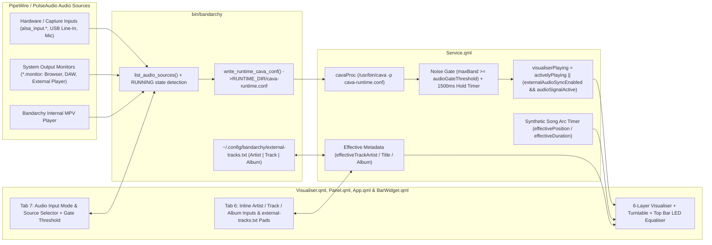

# Bandarchy Implementation Plan: External Audio Input Synchronisation & Separate `Artist / Track / Album` Metadata System

## 1. Confirmed Architecture, Scope & Non-Negotiable Guardrails

| Component | Target Files | Core Responsibility |
| :--- | :--- | :--- |
| **PipeWire / PulseAudio Source Scanner & Runtime Cava Config** | [`bin/bandarchy`](file:///home/matthew/Projects/bandarchy/bin/bandarchy), [`share/cava.conf`](file:///home/matthew/Projects/bandarchy/share/cava.conf) | Enumerates all PipeWire/PulseAudio sources (`pactl list sources`), classifies hardware/virtual capture inputs (`kind: "input"`) vs desktop output loopback monitors (`kind: "monitor"`), detects `RUNNING` streams, and writes a dynamic `cava-runtime.conf` targeting the active or user-selected source. |
| **Separate `external-tracks.txt` File & Backend CRUD** | [`share/external-tracks.txt`](file:///home/matthew/Projects/bandarchy/share/external-tracks.txt), [`bin/bandarchy`](file:///home/matthew/Projects/bandarchy/bin/bandarchy) | Stores external `Artist \| Track \| Album` entries in `~/.config/bandarchy/external-tracks.txt` (seeded from `share/external-tracks.txt`), **100% separate from `statements.txt`**. Supports loading, saving, resetting, and opening in external editor via `visualiser-config`. |
| **Live Signal Gate, Hotplug Polling & Synthetic Song Arc** | [`Service.qml`](file:///home/matthew/Projects/bandarchy/Service.qml) | Keeps `cavaProc` listening when external sync is enabled, evaluates a live noise-gate + `1500 ms` hold timer (`audioSignalActive`), exposes `visualiserPlaying`, advances a synthetic `0→100%` Song Progress Arc when local `mpv` is idle, and routes `effectiveTrackArtist`, `effectiveTrackTitle`, and `effectiveTrackAlbum`. |
| **Layer 6 `Artist / Track / Album` UI Editor & Tab 7 Audio Input Controls** | [`Visualiser.qml`](file:///home/matthew/Projects/bandarchy/Visualiser.qml), [`Panel.qml`](file:///home/matthew/Projects/bandarchy/Panel.qml), [`App.qml`](file:///home/matthew/Projects/bandarchy/App.qml), [`BarWidget.qml`](file:///home/matthew/Projects/bandarchy/BarWidget.qml) | Adds three inline text inputs (`Artist`, `Track`, `Album`) + clickable `external-tracks.txt` VJ pads + bulk editor in Layer `6: Typography`, adds Audio Input Sync mode & source selector pills in Tab `7: General & Quality`, and binds all visualiser stages and status-bar LED meters to `visualiserPlaying`. |

> [!CAUTION]
> **NON-NEGOTIABLE GUARDRAILS FOR THE IMPLEMENTING AI**
> 1. **DO NOT ADD, MODIFY, OR OVERWRITE ANY KEYBINDINGS**:
>    - Do **NOT** add any new `Keys.onPressed` handlers or alter any existing keyboard shortcuts in [`Visualiser.qml`](file:///home/matthew/Projects/bandarchy/Visualiser.qml), [`Panel.qml`](file:///home/matthew/Projects/bandarchy/Panel.qml), or [`App.qml`](file:///home/matthew/Projects/bandarchy/App.qml).
>    - All new functionality (switching audio input mode/source, applying/saving `Artist / Track / Album`, stepping to previous/next external track entry, opening `external-tracks.txt`) MUST be operated exclusively via UI buttons, pills, sliders, and text inputs.
>    - The **only** keyboard-related change permitted is appending the new `TextInput` / `TextEdit` focus states (`externalArtistInput.activeFocus || externalTrackInput.activeFocus || externalAlbumInput.activeFocus || externalTracksBulkEdit.activeFocus`) to `readonly property bool textInputFocused` at line 291 of [`Visualiser.qml`](file:///home/matthew/Projects/bandarchy/Visualiser.qml#L291) so typing into those fields does not accidentally trigger existing single-key visualiser shortcuts (`Q`, `W`, `E`, `R`, `A`, `T`, etc.).
> 2. **STRICT SEPARATION FROM `statements.txt`**:
>    - External `Artist / Track / Album` metadata MUST use its own dedicated file (`~/.config/bandarchy/external-tracks.txt`, seeded from `share/external-tracks.txt`) and its own UI editor.
>    - Never store or mix `Artist / Track / Album` lines in `statements.txt`. Layer 6 toggles `Q` (`Artist`), `W` (`Track`), and `E` (`Album`) display the active `Artist / Track / Album`, whilst `R` (`Statements`) continues to read exclusively from `statements.txt`.
> 3. **BRITISH ENGLISH ONLY**:
>    - Use standard British English spelling across all comments, UI labels, properties, and commit messages (`visualiser`, `synchronise`, `colour`, `normalise`, `behaviour`, `centre`, `analogue`, `recognise`, `initialise`).

---

## 2. End-to-End Architecture & Signal Flow



### Why the Visualiser Currently Fails to React Without Internal Playback
1. **Static Cava Source ([`share/cava.conf`](file:///home/matthew/Projects/bandarchy/share/cava.conf#L13-L15))**:
   - `method = pulse` and `source = auto` only monitor the default output sink's `.monitor` loopback. It never switches to a hardware capture input (`alsa_input.*`, USB audio interface, line-in, or microphone) when initiated.
2. **Gated Process Execution ([`Service.qml`](file:///home/matthew/Projects/bandarchy/Service.qml#L760-L763))**:
   - `cavaProc.running` is bound to `root.activelyPlaying || root.visualiserActive || root.fullscreenVisualiserOpen`. When the user is only viewing the status bar (`BarWidget.qml`) or has not started internal `mpv` playback, `cavaProc` is stopped.
3. **Hardcoded `activelyPlaying` Bindings**:
   - [`Panel.qml`](file:///home/matthew/Projects/bandarchy/Panel.qml#L759) (`lines 759, 2225, 2636, 2719`), [`App.qml`](file:///home/matthew/Projects/bandarchy/App.qml#L2483) (`line 2483`), and [`BarWidget.qml`](file:///home/matthew/Projects/bandarchy/BarWidget.qml#L40) (`line 40`) bind `playing` / `active` / `isPlaying` to `service.activelyPlaying` (`root.playing && !root.paused` from internal `mpv`).
   - Inside [`PsychedelicEngine.js`](file:///home/matthew/Projects/bandarchy/PsychedelicEngine.js#L2234-L2244) (`stepState(state, rawBands, active, cfg, dt)`), when `active` (`playing`) is `false`, `timeStep`, `l1Time`, `eqSpinTime`, `backdropTime`, and `l3EvoPhase` drop to slow idle speeds, [`Spectrum.qml`](file:///home/matthew/Projects/bandarchy/Spectrum.qml#L74-L76) forces `v = 0.06`, and [`BarWidget.qml`](file:///home/matthew/Projects/bandarchy/BarWidget.qml#L257-L270) forces `bandVal = 0.12` and `litSegments = 1`.
4. **Frozen Song Progress Arc (`trackProgress = 0.0`)**:
   - In [`Visualiser.qml`](file:///home/matthew/Projects/bandarchy/Visualiser.qml#L3214-L3216), `trackProg` is `dur > 0.5 ? pos / dur : 0.0`. Without internal `mpv` duration/position, `trackProg` stays at `0.0`, freezing Song Progress Arc modes `1..4` (`Climax 75%`, `Dismantle`, `Rebuild`, `Quarters`).

---

## 3. Component 1 — Seed File & Backend Support in `bin/bandarchy`

### 3.1 Create Seed File [`share/external-tracks.txt`](file:///home/matthew/Projects/bandarchy/share/external-tracks.txt)
Create `/home/matthew/Projects/bandarchy/share/external-tracks.txt` with default seed entries formatted as `Artist | Track | Album`:

```text
# Bandarchy — External Audio Track Metadata (Artist | Track | Album)
# Used by Layer 6 (6: Typography) Q (Artist), W (Track), and E (Album)
# when synchronising the visualiser to external audio inputs or streams.
# Format: Artist | Track | Album   (one entry per line; '#' comments ignored)
# Your personal copy lives at: ~/.config/bandarchy/external-tracks.txt

The Black Dog | Cost II | Music for Real Airports
Boards of Canada | Roygbiv | Music Has the Right to Children
Porcupine Tree | Voyage 34 (Phase I) | Voyage 34: The Complete Trip
Aphex Twin | Xtal | Selected Ambient Works 85-92
Autechre | Nil | Amber
King Gizzard & The Lizard Wizard | Robot Stop | Nonagon Infinity
Max Richter | On the Nature of Daylight | The Blue Notebooks
Plaid | Eyen | Rest Proof Clockwork
```

### 3.2 Add File Constants in [`bin/bandarchy`](file:///home/matthew/Projects/bandarchy/bin/bandarchy#L81-L86)
Right after `DEFAULT_STATEMENTS_FILE` (lines 81–86 of [`bin/bandarchy`](file:///home/matthew/Projects/bandarchy/bin/bandarchy#L81-L86) and after `RUNTIME_DIR` at line 158), define:

```python
EXTERNAL_TRACKS_FILE = os.path.join(CONFIG_DIR, "external-tracks.txt")
DEFAULT_EXTERNAL_TRACKS_FILE = os.path.join(
    os.path.dirname(os.path.dirname(os.path.abspath(__file__))), "share", "external-tracks.txt"
)
DEFAULT_CAVA_CONF_FILE = os.path.join(
    os.path.dirname(os.path.dirname(os.path.abspath(__file__))), "share", "cava.conf"
)
RUNTIME_CAVA_CONF = os.path.join(RUNTIME_DIR, "cava-runtime.conf")
```

### 3.3 External Tracks Parser, Loader, Saver & Resetter in [`bin/bandarchy`](file:///home/matthew/Projects/bandarchy/bin/bandarchy#L7150)
Right after `reset_statements()` (around line 7154 of [`bin/bandarchy`](file:///home/matthew/Projects/bandarchy/bin/bandarchy#L7154)), add the external tracks helper functions:

```python
DEFAULT_EXTERNAL_TRACKS_FALLBACK = [
    {"artist": "The Black Dog", "track": "Cost II", "album": "Music for Real Airports", "raw": "The Black Dog | Cost II | Music for Real Airports"},
    {"artist": "Boards of Canada", "track": "Roygbiv", "album": "Music Has the Right to Children", "raw": "Boards of Canada | Roygbiv | Music Has the Right to Children"},
    {"artist": "Porcupine Tree", "track": "Voyage 34 (Phase I)", "album": "Voyage 34: The Complete Trip", "raw": "Porcupine Tree | Voyage 34 (Phase I) | Voyage 34: The Complete Trip"},
    {"artist": "Aphex Twin", "track": "Xtal", "album": "Selected Ambient Works 85-92", "raw": "Aphex Twin | Xtal | Selected Ambient Works 85-92"},
]


def parse_external_track_entry(item) -> dict[str, str] | None:
    """Parse a dict or 'Artist | Track | Album' line into a normalised external track dict."""
    if isinstance(item, dict):
        artist = bounded_text(item.get("artist") or "", 120).strip()
        track = bounded_text(item.get("track") or item.get("title") or "", 120).strip()
        album = bounded_text(item.get("album") or "", 120).strip()
    else:
        line = bounded_text(str(item or ""), 360).strip()
        if not line or line.startswith("#"):
            return None
        if "|" in line:
            parts = [p.strip() for p in line.split("|", 2)]
        elif " — " in line:
            parts = [p.strip() for p in line.split(" — ", 2)]
        elif " - " in line:
            parts = [p.strip() for p in line.split(" - ", 2)]
        else:
            parts = [line, "", ""]
        artist = bounded_text(parts[0] if len(parts) > 0 else "", 120)
        track = bounded_text(parts[1] if len(parts) > 1 else "", 120)
        album = bounded_text(parts[2] if len(parts) > 2 else "", 120)
    if not (artist or track or album):
        return None
    raw = " | ".join([artist, track, album]).strip(" |")
    return {"artist": artist, "track": track, "album": album, "raw": raw}


def _default_external_tracks_seed_text() -> str:
    seed_txt = safe_read_text(DEFAULT_EXTERNAL_TRACKS_FILE, max_bytes=256 * 1024)
    if seed_txt and seed_txt.strip():
        return seed_txt
    header = (
        "# Bandarchy — External Audio Track Metadata (Artist | Track | Album)\n"
        "# Format: Artist | Track | Album   (one entry per line; '#' comments ignored)\n"
        "# Your personal copy lives at: ~/.config/bandarchy/external-tracks.txt\n\n"
    )
    return header + "\n".join(item["raw"] for item in DEFAULT_EXTERNAL_TRACKS_FALLBACK) + "\n"


def load_external_tracks() -> list[dict[str, str]]:
    ensure_private_dir(CONFIG_DIR)
    if not os.path.exists(EXTERNAL_TRACKS_FILE):
        seed_txt = _default_external_tracks_seed_text()
        safe_write_bytes(EXTERNAL_TRACKS_FILE, seed_txt.encode("utf-8"), mode=0o600, fatal=False)
    raw = safe_read_text(EXTERNAL_TRACKS_FILE, max_bytes=256 * 1024)
    if not raw:
        raw = _default_external_tracks_seed_text()
    entries: list[dict[str, str]] = []
    seen: set[tuple[str, str, str]] = set()
    for line in raw.splitlines():
        parsed = parse_external_track_entry(line)
        if not parsed:
            continue
        key = (parsed["artist"].casefold(), parsed["track"].casefold(), parsed["album"].casefold())
        if key in seen:
            continue
        seen.add(key)
        entries.append(parsed)
        if len(entries) >= 500:
            break
    return entries if entries else list(DEFAULT_EXTERNAL_TRACKS_FALLBACK)


def save_external_tracks(raw_entries: list | str) -> list[dict[str, str]]:
    ensure_private_dir(CONFIG_DIR)
    if isinstance(raw_entries, str):
        candidates = raw_entries.splitlines()
    elif isinstance(raw_entries, list):
        candidates = raw_entries
    else:
        candidates = []
    cleaned: list[dict[str, str]] = []
    seen: set[tuple[str, str, str]] = set()
    for item in candidates:
        parsed = parse_external_track_entry(item)
        if not parsed:
            continue
        key = (parsed["artist"].casefold(), parsed["track"].casefold(), parsed["album"].casefold())
        if key in seen:
            continue
        seen.add(key)
        cleaned.append(parsed)
        if len(cleaned) >= 500:
            break
    if not cleaned:
        cleaned = list(DEFAULT_EXTERNAL_TRACKS_FALLBACK)
    header = (
        "# Bandarchy — External Audio Track Metadata (Artist | Track | Album)\n"
        "# Used by Layer 6 (6: Typography) Q (Artist), W (Track), and E (Album)\n"
        "# when synchronising the visualiser to external audio inputs or streams.\n"
        "# Format: Artist | Track | Album   (one entry per line; '#' comments ignored)\n"
        "# Your personal copy lives at: ~/.config/bandarchy/external-tracks.txt\n\n"
    )
    body = "\n".join(f"{e['artist']} | {e['track']} | {e['album']}" for e in cleaned) + "\n"
    safe_write_bytes(EXTERNAL_TRACKS_FILE, (header + body).encode("utf-8"), mode=0o600, fatal=False)
    return load_external_tracks()


def reset_external_tracks() -> list[dict[str, str]]:
    ensure_private_dir(CONFIG_DIR)
    seed_txt = _default_external_tracks_seed_text()
    safe_write_bytes(EXTERNAL_TRACKS_FILE, seed_txt.encode("utf-8"), mode=0o600, fatal=False)
    return load_external_tracks()
```

### 3.4 PipeWire / PulseAudio Source Scanner & Runtime Cava Config Generator in [`bin/bandarchy`](file:///home/matthew/Projects/bandarchy/bin/bandarchy)
Add `list_audio_sources()`, `resolve_target_audio_source()`, and `write_runtime_cava_conf()`:

```python
_SAFE_PULSE_SOURCE_RE = re.compile(r"^[A-Za-z0-9_.\-:@/]+$")


def list_audio_sources() -> list[dict[str, str]]:
    """Query `pactl list sources` and return classified hardware/virtual inputs and output monitors."""
    pactl_bin = resolve_bin("pactl")
    if not pactl_bin:
        return []
    try:
        res = subprocess.run(
            [pactl_bin, "list", "sources"],
            stdin=subprocess.DEVNULL,
            stdout=subprocess.PIPE,
            stderr=subprocess.DEVNULL,
            timeout=2.5,
            check=False,
            text=True,
        )
        out = res.stdout or ""
    except Exception:
        return []

    sources: list[dict[str, str]] = []
    cur: dict[str, str] = {}
    for raw_line in out.splitlines():
        line = raw_line.strip()
        if line.startswith("Source #"):
            if cur.get("name"):
                sources.append(cur)
            cur = {"name": "", "description": "", "state": "SUSPENDED", "kind": "input"}
        elif line.startswith("State:"):
            cur["state"] = bounded_text(line.split(":", 1)[1].strip().upper(), 32)
        elif line.startswith("Name:"):
            name = bounded_text(line.split(":", 1)[1].strip(), 240)
            if _SAFE_PULSE_SOURCE_RE.match(name):
                cur["name"] = name
                if name.endswith(".monitor"):
                    cur["kind"] = "monitor"
        elif line.startswith("Description:"):
            cur["description"] = bounded_text(line.split(":", 1)[1].strip(), 160)
        elif line.startswith("device.class =") or line.startswith("media.class ="):
            val = line.split("=", 1)[1].strip().strip('"').lower()
            if "monitor" in val or "sink" in val:
                cur["kind"] = "monitor"
    if cur.get("name"):
        sources.append(cur)
    return sources


def resolve_target_audio_source(
    mode: str,
    selected_source: str,
    sources: list[dict[str, str]],
    mpv_playing: bool = False,
) -> tuple[str, str]:
    """Return (cava_source_string, human_label) based on audioInputMode and live source states."""
    clean_mode = str(mode or "auto").strip().lower()
    clean_sel = str(selected_source or "auto").strip()
    if clean_sel and clean_sel != "auto" and _SAFE_PULSE_SOURCE_RE.match(clean_sel):
        for s in sources:
            if s["name"] == clean_sel:
                return s["name"], (s.get("description") or s["name"])

    inputs = [s for s in sources if s.get("kind") == "input"]
    monitors = [s for s in sources if s.get("kind") == "monitor"]
    running_inputs = [s for s in inputs if s.get("state") == "RUNNING"]
    running_monitors = [s for s in monitors if s.get("state") == "RUNNING"]

    if clean_mode == "player":
        return "auto", "Bandarchy Player (Default Monitor)"
    if clean_mode == "input":
        if running_inputs:
            return running_inputs[0]["name"], (running_inputs[0].get("description") or running_inputs[0]["name"])
        if inputs:
            return inputs[0]["name"], (inputs[0].get("description") or inputs[0]["name"])
        return "auto", "Default Audio Input"
    if clean_mode == "monitor":
        # Prefer hardware speaker/headphone monitor over virtual sinks when multiple are running
        hw_running = [m for m in running_monitors if m["name"].startswith("alsa_output.")]
        pick = hw_running[0] if hw_running else (running_monitors[0] if running_monitors else (monitors[0] if monitors else None))
        if pick:
            return pick["name"], (pick.get("description") or pick["name"])
        return "auto", "System Output Monitor"

    # Default "auto" mode:
    # 1. If Bandarchy's internal mpv is not actively playing and a capture input is RUNNING, lock onto that capture input.
    # 2. Otherwise if a system output monitor is RUNNING, lock onto that monitor.
    # 3. Fallback to "auto".
    if not mpv_playing and running_inputs:
        return running_inputs[0]["name"], (running_inputs[0].get("description") or running_inputs[0]["name"])
    hw_running = [m for m in running_monitors if m["name"].startswith("alsa_output.")]
    if hw_running:
        return hw_running[0]["name"], (hw_running[0].get("description") or hw_running[0]["name"])
    if running_monitors:
        return running_monitors[0]["name"], (running_monitors[0].get("description") or running_monitors[0]["name"])
    return "auto", "Auto-Sense (Default Monitor / Input)"


def write_runtime_cava_conf(source_name: str = "auto") -> str:
    """Generate a private runtime cava.conf in RUNTIME_DIR pointing at `source_name`."""
    clean_src = str(source_name or "auto").strip()
    if not clean_src or not _SAFE_PULSE_SOURCE_RE.match(clean_src):
        clean_src = "auto"
    base_txt = safe_read_text(DEFAULT_CAVA_CONF_FILE, max_bytes=64 * 1024) or ""
    if not base_txt.strip():
        base_txt = (
            "[general]\nmode = normal\nframerate = 45\nbars = 64\nautosens = 1\nsensitivity = 180\n"
            "lower_cutoff_freq = 25\nhigher_cutoff_freq = 16500\n\n"
            "[input]\nmethod = pulse\nsource = auto\n\n"
            "[output]\nmethod = raw\nraw_target = /dev/stdout\ndata_format = ascii\n"
            "ascii_max_range = 1000\nbar_delimiter = 59\nframe_delimiter = 10\n"
            "channels = mono\nmono_option = average\n\n[smoothing]\nnoise_reduction = 20\n"
        )
    updated_lines = []
    replaced = False
    for line in base_txt.splitlines():
        if line.strip().startswith("source") and "=" in line:
            updated_lines.append(f"source = {clean_src}")
            replaced = True
        else:
            updated_lines.append(line)
    if not replaced:
        updated_lines.append(f"\n[input]\nsource = {clean_src}")
    out_txt = "\n".join(updated_lines) + "\n"
    safe_write_bytes(RUNTIME_CAVA_CONF, out_txt.encode("utf-8"), mode=0o600, fatal=False)
    return RUNTIME_CAVA_CONF if os.path.exists(RUNTIME_CAVA_CONF) else DEFAULT_CAVA_CONF_FILE
```

### 3.5 Update `cmd_visualiser_config` and `_kill_bandarchy_processes` in [`bin/bandarchy`](file:///home/matthew/Projects/bandarchy/bin/bandarchy#L7156-L7255)
1. In `cmd_visualiser_config(args)` (lines 7156–7205):
   - Handle `--reset-external-tracks`, `--save-external-tracks <json>`, and `--open-external-tracks` identically to `--reset-statements`, `--save-statements`, and `--open-statements`.
   - Strip `"externalTracks"`, `"externalTracksPath"`, `"saveExternalTracks"`, `"audioSources"`, `"activeAudioSource"`, `"activeAudioSourceLabel"`, and `"runtimeCavaConfPath"` from `incoming_clean` before writing `visualiser.json`.
   - Call `sources = list_audio_sources()`, resolve `active_src, active_label = resolve_target_audio_source(existing.get("audioInputMode", "auto"), existing.get("audioInputSource", "auto"), sources, mpv_playing=False)`, and call `cava_conf_path = write_runtime_cava_conf(active_src)`.
   - Include in the emitted JSON dictionary:
     ```python
     "externalTracks": external_tracks_list,
     "externalTracksPath": EXTERNAL_TRACKS_FILE,
     "audioSources": sources,
     "activeAudioSource": active_src,
     "activeAudioSourceLabel": active_label,
     "runtimeCavaConfPath": cava_conf_path,
     ```
2. In `_kill_bandarchy_processes` (lines 7248–7252):
   - Update `is_bandarchy_cava` so it matches both `cava.conf` and `cava-runtime.conf`:
     ```python
     is_bandarchy_cava = (
         exe_name == "cava"
         and "-p" in parts
         and any(
             ("bandarchy" in p or "io.github.layolayo.bandarchy" in p)
             and (p.endswith("cava.conf") or p.endswith("cava-runtime.conf"))
             for p in parts
         )
     )
     ```
3. In the `argparse` parser definition for `visualiser-config` (search for `add_parser("visualiser-config"` in `bin/bandarchy`), add:
   ```python
   p_vc.add_argument("--save-external-tracks", default=None)
   p_vc.add_argument("--reset-external-tracks", action="store_true")
   p_vc.add_argument("--open-external-tracks", action="store_true")
   ```

---

## 4. Component 2 — Live Signal Gate, Dynamic Cava & Metadata Routing in `Service.qml`

### 4.1 New Properties on [`Service.qml`](file:///home/matthew/Projects/bandarchy/Service.qml#L161-L166)
Around line 161 of [`Service.qml`](file:///home/matthew/Projects/bandarchy/Service.qml#L161-L166), add:

```qml
    // 60 FPS 64-band Cava spectrum & External Audio Input Synchronisation state
    property var spectrumBands: []
    property string runtimeCavaConfPath: ""
    property string audioInputMode: "auto" // "auto", "input", "monitor", "player"
    property string audioInputSource: "auto" // "auto" or specific PipeWire/PulseAudio source name
    property string activeAudioSource: "auto"
    property string activeAudioSourceLabel: "Auto-Sense (Default Monitor / Input)"
    property var audioSources: []
    property int audioGateThreshold: 35 // Raw Cava band value (0..1000) required to open signal gate
    property bool audioSignalActive: false

    // Separate External Track Metadata state (~/.config/bandarchy/external-tracks.txt)
    property string externalMetadataMode: "auto" // "auto" (Bandarchy player when playing, else external) or "custom" (always external)
    property string externalArtist: "The Black Dog"
    property string externalTrack: "Cost II"
    property string externalAlbum: "Music for Real Airports"
    property var externalTracksList: []
    property string externalTracksPath: "~/.config/bandarchy/external-tracks.txt"
    property int externalTrackIndex: 0

    // Synthetic Song Progress Arc state when driven by external audio (no local mpv duration)
    property real externalArcPosition: 0.0
    property real externalArcDuration: 240.0

    readonly property bool activelyPlaying: root.playing && !root.paused
    readonly property bool externalAudioSyncEnabled: root.audioInputMode !== "player"
    readonly property bool visualiserPlaying: root.activelyPlaying || (root.externalAudioSyncEnabled && root.audioSignalActive)
    readonly property bool usingExternalMetadata: (root.externalMetadataMode === "custom") || (!root.activelyPlaying && root.externalAudioSyncEnabled)

    readonly property string effectiveTrackArtist: root.usingExternalMetadata
        ? (root.externalArtist || root.trackArtist)
        : root.trackArtist
    readonly property string effectiveTrackTitle: root.usingExternalMetadata
        ? (root.externalTrack || root.trackTitle)
        : root.trackTitle
    readonly property string effectiveTrackAlbum: root.usingExternalMetadata
        ? (root.externalAlbum || root.trackAlbum)
        : root.trackAlbum
    readonly property real effectivePosition: (root.activelyPlaying && root.duration > 0.5)
        ? root.position
        : (root.visualiserPlaying ? root.externalArcPosition : root.position)
    readonly property real effectiveDuration: (root.activelyPlaying && root.duration > 0.5)
        ? root.duration
        : (root.visualiserPlaying ? Math.max(30.0, root.externalArcDuration) : root.duration)
```

### 4.2 Signal Hold Timer, Synthetic Song Arc Timer & Source Auto-Sense Timer in [`Service.qml`](file:///home/matthew/Projects/bandarchy/Service.qml#L190-L202)
1. **Signal Hold Timer (`audioSignalHoldTimer`)**:
   - Prevents brief 100–800 ms musical rests between bars from dropping `audioSignalActive` to `false`:
     ```qml
     Timer {
         id: audioSignalHoldTimer
         interval: 1500
         repeat: false
         onTriggered: root.audioSignalActive = false
     }
     ```
2. **Update `playheadTickTimer` (lines 190–201)**:
   - Also advance `externalArcPosition` when `!root.activelyPlaying && root.visualiserPlaying`:
     ```qml
     Timer {
         id: playheadTickTimer
         interval: 250
         running: root.activelyPlaying || root.visualiserPlaying
         repeat: true
         onTriggered: {
             if (root.activelyPlaying) {
                 var nextPos = root.position + 0.25
                 root.position = (root.duration > 0.5) ? Math.min(root.duration, nextPos) : nextPos
             } else if (root.visualiserPlaying) {
                 var cycleDur = Math.max(30.0, root.externalArcDuration || 240.0)
                 root.externalArcPosition = (root.externalArcPosition + 0.25) % cycleDur
             }
         }
     }
     ```
3. **Update `cavaProc` (lines 760–779)**:
   - Use `root.runtimeCavaConfPath || root.cavaConfPath`, keep `cavaProc` running whenever `externalAudioSyncEnabled` is active and either the visualiser or top-bar LED is active, and trigger `audioSignalActive` when `maxVal >= root.audioGateThreshold`:
     ```qml
     Process {
         id: cavaProc
         command: ["/usr/bin/cava", "-p", (root.runtimeCavaConfPath || root.cavaConfPath)]
         running: root.activelyPlaying || root.visualiserActive || root.fullscreenVisualiserOpen || (root.externalAudioSyncEnabled && root.topBarLedEnabled)
         stdout: SplitParser {
             onRead: line => {
                 var parts = line.trim().split(";")
                 if (parts.length < 16) return
                 var vals = []
                 var maxVal = 0
                 for (var i = 0; i < parts.length; i++) {
                     if (parts[i] === "") continue
                     var n = parseInt(parts[i], 10)
                     var cleanN = isNaN(n) ? 0 : n
                     vals.push(cleanN)
                     if (cleanN > maxVal) maxVal = cleanN
                 }
                 if (vals.length >= 16) {
                     root.spectrumBands = vals
                     if (maxVal >= Math.max(10, root.audioGateThreshold)) {
                         root.audioSignalActive = true
                         audioSignalHoldTimer.restart()
                     }
                 }
             }
         }
     }
     ```
4. **Update `visualiserConfigProc.onExited` (lines 590–634)**:
   - Hydrate `root.externalTracksList`, `root.externalTracksPath`, `root.audioSources`, `root.activeAudioSource`, `root.activeAudioSourceLabel`, and `root.runtimeCavaConfPath` (restarting `cavaProc` if `runtimeCavaConfPath` or `activeAudioSource` changed!).
   - Hydrate `root.audioInputMode`, `root.audioInputSource`, `root.audioGateThreshold`, `root.externalMetadataMode`, `root.externalArtist`, `root.externalTrack`, `root.externalAlbum`, and `root.externalArcDuration` from `d.config`.
5. **Add Helper Functions on `Service.qml` (around line 735)**:
   - `openExternalTracksFile()` (`--open-external-tracks`)
   - `saveExternalTracks(tracksArr)` (`--save-external-tracks`)
   - `resetExternalTracksFile()` (`--reset-external-tracks`)
   - `setExternalTrackMetadata(artist, track, album)` (updates `externalArtist`, `externalTrack`, `externalAlbum`, resets `externalArcPosition = 0.0`, saves to `visualiserConfig`, and calls `refreshAsciiArt()`)
   - `setAudioInputConfig(mode, sourceName)` (updates `audioInputMode` and `audioInputSource`, saves to `visualiserConfig`, and reloads `loadVisualiserConfig()` so `bin/bandarchy` writes the updated `cava-runtime.conf` and restarts `cavaProc`).
6. **Update `refreshAsciiArt()` in [`Service.qml`](file:///home/matthew/Projects/bandarchy/Service.qml#L875-L877)**:
   - Use `root.effectiveTrackArtist`, `root.effectiveTrackTitle`, and `root.effectiveTrackAlbum` at lines 875–877 so Omarchy ASCII banner transcoding and TTE keyframes display the user's external `Artist / Track / Album` when synchronised to external audio.

---

## 5. Component 3 — Visualiser UI (`Visualiser.qml`) & Bindings (`Panel.qml`, `App.qml`, `BarWidget.qml`)

### 5.1 Properties, Signals & Focus Guard in [`Visualiser.qml`](file:///home/matthew/Projects/bandarchy/Visualiser.qml)
1. **Add Properties (around line 290 of [`Visualiser.qml`](file:///home/matthew/Projects/bandarchy/Visualiser.qml#L290))**:
   ```qml
   // External Audio Input Synchronisation & Separate External Tracks (Artist | Track | Album)
   property string audioInputMode: "auto" // "auto", "input", "monitor", "player"
   property string audioInputSource: "auto"
   property string activeAudioSource: "auto"
   property string activeAudioSourceLabel: "Auto-Sense"
   property var audioSources: []
   property int audioGateThreshold: 35
   property real externalArcDuration: 240.0

   property string externalMetadataMode: "auto" // "auto" or "custom"
   property string externalArtist: "The Black Dog"
   property string externalTrack: "Cost II"
   property string externalAlbum: "Music for Real Airports"
   property var externalTracksList: []
   property string externalTracksPath: "~/.config/bandarchy/external-tracks.txt"
   property int externalTrackIndex: 0
   property bool showExternalTracksEditor: false
   property bool externalTracksBulkMode: false
   property int editingExternalTrackIndex: -1
   property string externalTracksStatusText: ""
   ```
2. **Update `textInputFocused` Guard (line 291 of [`Visualiser.qml`](file:///home/matthew/Projects/bandarchy/Visualiser.qml#L291))**:
   > [!IMPORTANT]
   > Do **NOT** modify any `Keys.onPressed` code. Only extend `textInputFocused` at line 291 so typing in the new text inputs suppresses single-key shortcuts:
   ```qml
   readonly property bool textInputFocused: Boolean(
       statementSingleInput.activeFocus
       || statementBulkEdit.activeFocus
       || customPhotoPathInput.activeFocus
       || externalArtistInput.activeFocus
       || externalTrackInput.activeFocus
       || externalAlbumInput.activeFocus
       || externalTracksBulkEdit.activeFocus
   )
   ```
   Also include `!root.showExternalTracksEditor` in the HUD auto-hide timer condition at lines 5223 and 5226.
3. **Add Signals (around line 871 of [`Visualiser.qml`](file:///home/matthew/Projects/bandarchy/Visualiser.qml#L871))**:
   ```qml
   signal requestOpenExternalTracksFile()
   signal requestReloadExternalTracksFile()
   signal requestSaveExternalTracks(var tracksArray)
   signal requestResetExternalTracks()
   signal requestRefreshAudioSources()
   ```

### 5.2 Layer 6 (`6: Typography`) Dedicated `Artist / Track / Album` Input Bar & `external-tracks.txt` Editor
In [`Visualiser.qml`](file:///home/matthew/Projects/bandarchy/Visualiser.qml#L11094) (immediately after `statementsEditorBox` at line 11444 inside `visible: root.activeConfigLayer === 6`), add a dedicated **External / Custom `Artist · Track · Album` Bar & Editor**:
1. **Compact Control Row (Always Visible in Tab `6: Typography`)**:
   - Label: `"External / Custom Track Metadata (Q/W/E):"`
   - Mode Toggle Pill:
     - `"󰎆 Source: Auto (Player → External)"` (`externalMetadataMode === "auto"`) vs `"󰏫 Source: Custom / external-tracks.txt"` (`externalMetadataMode === "custom"`).
   - Three Inline `TextInput` Boxes side-by-side:
     - `externalArtistInput` (placeholder `"Artist (Q)…"`, bound to `root.externalArtist`)
     - `externalTrackInput` (placeholder `"Track (W)…"`, bound to `root.externalTrack`)
     - `externalAlbumInput` (placeholder `"Album (E)…"`, bound to `root.externalAlbum`)
   - Action Pills:
     - `"󰄬 Apply Live"` — sets `externalMetadataMode = "custom"`, enables `layer3Enabled = true`, updates `externalArtist` / `externalTrack` / `externalAlbum`, and triggers `scheduleSaveVisualiserConfig()`.
     - `"+ Save to File"` — prepends or updates `{ artist, track, album }` in `externalTracksList` and emits `requestSaveExternalTracks(externalTracksList)`.
     - `"󰒮 Prev"` / `"󰒭 Next"` — steps backward/forward through `root.externalTracksList` and applies that entry live.
     - `"󰏫 Track List [" + externalTracksList.length + "]"` — toggles `root.showExternalTracksEditor`.
     - `"󰏫 Open File"` (`requestOpenExternalTracksFile()`) and `"󰑐 Reload"` (`requestReloadExternalTracksFile()`).
2. **Expandable `externalTracksEditorBox` (`visible: root.showExternalTracksEditor`)**:
   - Mirrors the layout of `statementsEditorBox` (lines 11096–11444), providing:
     - **Interactive VJ Pads Mode (`!root.externalTracksBulkMode`)**: Clickable pills for each entry in `externalTracksList` displaying `"1. Artist — Track (Album)"` (click to push live onto Layer 6 `Q / W / E`, `󰏫` to load into the 3 inline boxes for editing, `✕` to delete).
     - **Bulk Text / Paste Mode (`root.externalTracksBulkMode`)**: Multi-line `TextEdit` (`externalTracksBulkEdit`) displaying one `Artist | Track | Album` entry per line with `"󰆓 Save All Lines to external-tracks.txt"` and `"󰁯 Reset Defaults"`.

### 5.3 Tab 7 (`7: General & Quality`) Audio Input Synchronisation Section
In [`Visualiser.qml`](file:///home/matthew/Projects/bandarchy/Visualiser.qml#L12033) (inside `visible: root.activeConfigLayer === 7`, above or below Section 3 at line 12033), add a dedicated **Audio Input Source & Synchronisation** panel:
1. **4 Audio Input Mode Pills (`root.audioInputMode`)**:
   - `"1. Auto-Sense Any Initiated Audio"` (`"auto"`)
   - `"2. Hardware / Capture Input (Line-In / USB / Mic)"` (`"input"`)
   - `"3. System Output Monitor (Desktop Audio)"` (`"monitor"`)
   - `"4. Bandarchy Internal Player Only"` (`"player"`)
2. **Discovered PipeWire / PulseAudio Sources Flow**:
   - `"Auto Select"` pill (`root.audioInputSource === "auto"`)
   - `Repeater` over `root.audioSources`: renders a `VizPillButton` for each discovered source showing an icon (`󰍬` for `kind === "input"`, `󰓃` for `kind === "monitor"`), its `description`, and a `[LIVE]` badge when `state === "RUNNING"`. Clicking locks `root.audioInputSource = modelData.name`.
   - `"󰑐 Scan Audio Inputs"` button (`root.requestRefreshAudioSources()`).
3. **2 Sliders**:
   - `LayerSlider` for `"Signal Gate Threshold"` (`root.audioGateThreshold`, `minValue: 10`, `maxValue: 250`, `integerSteps: true`).
   - `LayerSlider` for `"External Song Arc Cycle"` (`root.externalArcDuration`, `minValue: 60`, `maxValue: 600`, `integerSteps: true`, `unitSuffix: "s"`).

### 5.4 Update Bindings in [`Panel.qml`](file:///home/matthew/Projects/bandarchy/Panel.qml), [`App.qml`](file:///home/matthew/Projects/bandarchy/App.qml), and [`BarWidget.qml`](file:///home/matthew/Projects/bandarchy/BarWidget.qml)
1. **[`Panel.qml`](file:///home/matthew/Projects/bandarchy/Panel.qml)**:
   - In both `fsVisualiser` (lines 753–840) and `panelVisualiser` (lines 2220–2310), update:
     ```qml
     playing: root.service ? root.service.visualiserPlaying : false
     trackTitle: root.service ? root.service.effectiveTrackTitle : ""
     trackArtist: root.service ? root.service.effectiveTrackArtist : ""
     trackAlbum: root.service ? root.service.effectiveTrackAlbum : ""
     position: root.service ? root.service.effectivePosition : 0.0
     duration: root.service ? root.service.effectiveDuration : 0.0
     audioSources: root.service ? root.service.audioSources : []
     activeAudioSource: root.service ? root.service.activeAudioSource : "auto"
     activeAudioSourceLabel: root.service ? root.service.activeAudioSourceLabel : ""
     onRequestOpenExternalTracksFile: if (root.service) root.service.openExternalTracksFile()
     onRequestReloadExternalTracksFile: if (root.service) root.service.loadVisualiserConfig()
     onRequestSaveExternalTracks: tracksArr => { if (root.service) root.service.saveExternalTracks(tracksArr) }
     onRequestResetExternalTracks: if (root.service) root.service.resetExternalTracksFile()
     onRequestRefreshAudioSources: if (root.service) root.service.loadVisualiserConfig()
     ```
   - At line 2636 (mini turntable) and line 2719 (footer `Spectrum`), replace `root.service.activelyPlaying` with `root.service.visualiserPlaying`. (Keep transport Play/Pause button icons at lines 1380, 1577, and 2739 bound to `activelyPlaying` so internal player transport controls still reflect internal `mpv` state!).
2. **[`App.qml`](file:///home/matthew/Projects/bandarchy/App.qml)**:
   - In `appVisualiser` (lines 2477–2565), bind `playing: service.visualiserPlaying`, `trackTitle: service.effectiveTrackTitle`, `trackArtist: service.effectiveTrackArtist`, `trackAlbum: service.effectiveTrackAlbum`, `position: service.effectivePosition`, `duration: service.effectiveDuration`, `audioSources: service.audioSources`, `activeAudioSource: service.activeAudioSource`, `activeAudioSourceLabel: service.activeAudioSourceLabel`, and connect the 5 `onRequest*ExternalTracks*` / `onRequestRefreshAudioSources` signals to `service`.
3. **[`BarWidget.qml`](file:///home/matthew/Projects/bandarchy/BarWidget.qml)**:
   - At line 40, update `isPlaying` to:
     ```qml
     readonly property bool isPlaying: {
         try {
             return root.service ? Boolean(root.service.visualiserPlaying || root.service.activelyPlaying) : false
         } catch (e) {
             return false
         }
     }
     ```
   - At lines 60–71 (`tooltipText()`), use `root.service.effectiveTrackTitle` and `root.service.effectiveTrackArtist` (with fallback to `root.service.activeAudioSourceLabel` when synchronised to an external audio input).

---

## 6. Automated Verification Plan (`tests/test_bandarchy.py`)

Add a dedicated test method in [`tests/test_bandarchy.py`](file:///home/matthew/Projects/bandarchy/tests/test_bandarchy.py) verifying:
1. **`external-tracks.txt` Lifecycle & Separation from `statements.txt`**:
   - Calling `bin/bandarchy visualiser-config --get` seeds `~/.config/bandarchy/external-tracks.txt` and returns `externalTracks` (list of `{artist, track, album, raw}` objects) and `externalTracksPath`.
   - Calling `bin/bandarchy visualiser-config --save-external-tracks '["Orbital | Halcyon | In Sides", "Plaid - Ralome - Not for Threes"]'` persists both pipe-delimited and hyphen-delimited entries to `external-tracks.txt` without modifying `statements.txt`.
   - Calling `bin/bandarchy visualiser-config --reset-external-tracks` restores the seed entries.
2. **Dynamic Runtime Cava Configuration & Audio Source Discovery**:
   - Calling `bin/bandarchy visualiser-config --set '{"audioInputMode":"input","audioInputSource":"alsa_input.usb-test.stereo"}'` writes `cava-runtime.conf` in `RUNTIME_DIR` containing `source = alsa_input.usb-test.stereo` and returns `runtimeCavaConfPath`.
3. **Static QML & Keybinding Preservation Checks**:
   - Verify `Service.qml`, `Visualiser.qml`, `Panel.qml`, `App.qml`, and `BarWidget.qml` expose `visualiserPlaying`, `effectiveTrackArtist`, `effectiveTrackTitle`, `effectiveTrackAlbum`, `externalTracksList`, and `audioInputMode`.
   - Verify `Keys.onPressed` in `Visualiser.qml`, `Panel.qml`, and `App.qml` has **zero** new or overwritten keybindings.

Run the complete test suite with:
```bash
python3 /home/matthew/Projects/bandarchy/tests/test_bandarchy.py
```
