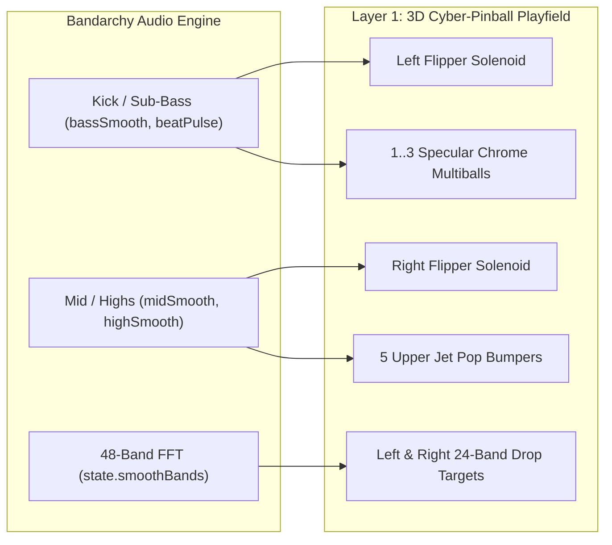
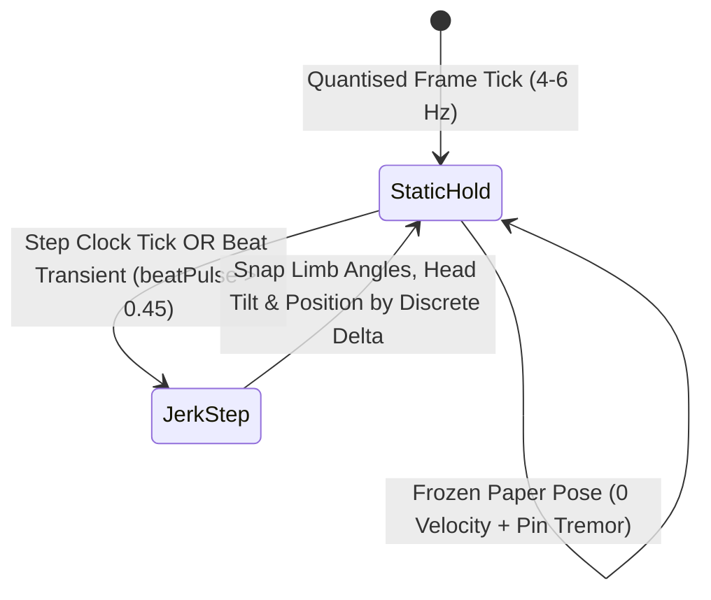

# Bandarchy Implementation Plan: L1 3D Pinball, L1 Cottingley Paper-Theatre Background & L3 Opaque Stop-Motion Elves/Fairies

## 1. Confirmed Architecture & Placement Decisions

| Feature | Target Layer | Mode / Style Label | Core Responsibility |
| :--- | :--- | :--- | :--- |
| **3D Cyber-Pinball Playfield** | **Layer 1 (`1: Worlds`)** | Full: `"3D Cyber-Pinball Playfield"`<br>Short: `"29:Pinball"` (or next L1 index) | Tilted 3D perspective pinball table with deterministic + audio-reactive multiball physics, kick-driven Left Flipper, snare/mid-driven Right Flipper, 5 pop bumpers, slingshots, wireform ramps, plunger lane, and 48-band FFT drop-target banks. |
| **Cottingley Paper-Theatre Glen (Fairy Background)** | **Layer 1 (`1: Worlds`)** | Full: `"Cottingley Paper-Theatre Glen"`<br>Short: `"30:FairyGlen"` (or next L1 index) | Edwardian/Victorian *Pollock's Paper Theatre* multi-plane woodland brook & botanical grotto constructed from **100% opaque scissor-cut card flats**, Victorian ink cross-hatching, mossy boulders, weeping willow/fern cut-outs, and brass hatpins in 3D parallax. |
| **Opaque Stop-Motion Elves & Fairies (Characters)** | **Layer 3 (`3: Vectors`)** | Full: `"Cottingley Paper Elves & Fairies"`<br>Short: `"PaperElves"` (Style #18, index `17`) | **Strictly opaque (`alpha = 1.0`)** scissor-cut card elves (mischievous) and fairies (Cottingley 1917 style) with brass split-pin joints and **quantised stop-motion ("statically jerk-style")** animation that crawl, creep, peek from screen bezels, and scuttle across *any* active Layer 1 world, Stark Photo, or Equaliser. |

> [!IMPORTANT]
> **Note on Layer 1 Mode Indexing for the Implementing AI**:
> Check `ALL_LAYER1_MODES` and `SHORT_LAYER1_MODES` at lines 30–67 of [`PsychedelicEngine.js`](file:///home/matthew/Projects/bandarchy/PsychedelicEngine.js#L30-L67) and `shortL1FieldLabels` at lines 605–633 of [`Visualiser.qml`](file:///home/matthew/Projects/bandarchy/Visualiser.qml#L605-L633) before appending:
> - Currently [`PsychedelicEngine.js`](file:///home/matthew/Projects/bandarchy/PsychedelicEngine.js#L58) has an uncommitted 28th entry (`"Citadel Heavy Gun Turret"` / `"28:Turret"` at index `27`), whereas [`Visualiser.qml`](file:///home/matthew/Projects/bandarchy/Visualiser.qml#L632) currently stops at `"27:Invaders"` (length 27).
> - Ensure `ALL_LAYER1_MODES`, `SHORT_LAYER1_MODES` (in `PsychedelicEngine.js`), and `shortL1FieldLabels` (in `Visualiser.qml`) have **identical lengths and 1:1 index parity** when adding `"3D Cyber-Pinball Playfield"` and `"Cottingley Paper-Theatre Glen"`.

---

## 2. Component 1 — Layer 1 World: `3D Cyber-Pinball Playfield`

### 2.1 Visual & Musical Design
A tilted 3D arcade pinball playfield (`pitch ≈ 48°`, subtle roll banking from `layer1Twist`, and physical cabinet nudge on heavy kicks) where the music drives the solenoids, bumpers, target banks, and multiball action in real time.



### 2.2 Playfield Coordinate Space & 3D Projection
- Define local playfield coordinates:
  - `tx ∈ [-1.00, +1.00]` (left cabinet rail to right shooter-lane wall; inner playfield divider at `tx = +0.82`, shooter lane in `[+0.82, +0.98]`).
  - `ty ∈ [-1.35, +1.35]` (`ty = -1.35` is the top arch / rollover lanes; `ty = +1.25` is the bottom flipper drain).
  - `tz ∈ [0.00, +0.35]` (elevation above the playfield glass).
- **Camera Projection Helper (`projectPinballPt(tx, ty, tz)`)**:
  - Apply cabinet tilt pitch (`pitch = 0.78 + Math.sin(l1T * 0.35) * 0.05`), dynamic roll (`roll = twist * 0.14 + Math.sin(l1T * 0.28) * 0.04`), and **cabinet nudge offset** (`nudgeX = Math.sin(state.t * 42.0) * state.beatPulse * minDim * 0.012`, `nudgeY = -state.beatPulse * minDim * 0.010`).
  - Project with perspective focal length `fov = minDim * 1.45` so the bottom flippers sit wide and close in the foreground while the upper bumper deck recedes cleanly toward the horizon.

### 2.3 Deterministic + Audio-Reactive Multiball State (`state.pinballState`)
Initialise `state.pinballState` lazily on `state` (or advance it each frame using `dt = clamp(state.dt || 0.016, 0.004, 0.05)`):
1. **Flippers (`leftFlipAngle`, `rightFlipAngle`)**:
   - Pivot points: Left Flipper at `(-0.34, +1.06)`, length `0.30`; Right Flipper at `(+0.26, +1.06)`, length `0.30`.
   - Rest angles: Left `+0.46 rad` (sloping down-right), Right `Math.PI - 0.46 rad` (sloping down-left).
   - Active stroke angles: Left `-0.42 rad` when `state.beatPulse > 0.28 || state.bassSmooth > 0.52`; Right `Math.PI + 0.42 rad` when `state.midSmooth > 0.45 || state.highSmooth > 0.48`.
2. **5 Upper Jet Pop Bumpers**:
   - Fixed playfield coordinates:
     - `B0: (-0.32, -0.58)`, `B1: (+0.24, -0.58)`, `B2: (-0.04, -0.32)`, `B3: (-0.42, -0.18)`, `B4: (+0.34, -0.18)`, each with radius `r = 0.12`.
   - Each bumper stores a `flash` value (`0.0..1.0`, decaying at `exp(-dt * 7.0)`).
3. **Left & Right Slingshots**:
   - Triangular kicker bumpers above the flippers:
     - Left Slingshot: `(-0.68, +0.52) → (-0.68, +0.88) → (-0.40, +0.94)`.
     - Right Slingshot: `(+0.60, +0.52) → (+0.60, +0.88) → (+0.32, +0.94)`.
4. **1 to 3 Chrome Pinballs (`balls[0..2]`)**:
   - Active ball count: `clamp(Math.round(1 + density), 1, 3)`.
   - Each ball maintains `{ x, y, vx, vy, trail: [] }`:
     - **Gravity**: `vy += 1.65 * l1Spd * dt`.
     - **Plunger Launch**: If a ball drains (`y > 1.32`) or starts in the shooter lane (`x > 0.82`), launch it upward from `(0.90, 1.18)` with `vy = -(2.6 + state.bassSmooth * 0.9) * l1Spd` around the top arch (`ty < -1.10` curves left into the upper rollover lanes).
     - **Bumper Collisions**: When `hypot(ball.x - b.x, ball.y - b.y) < b.r + 0.055`, push the ball radially outward with speed `1.85 * l1Spd * (1.0 + state.beatPulse * 0.35)` and set `b.flash = 1.0`.
     - **Flipper Hits**: When a ball enters the flipper sweep zone (`ty ∈ [0.92, 1.16]`, `tx ∈ [-0.42, +0.34]`), reflect `vy = -(2.1 + state.bassSmooth * 0.85 + state.beatPulse * 0.65) * l1Spd` and add lateral angle toward the bumpers.
     - **Trail History**: Keep the last `10` `(x, y)` positions per ball to draw a tapered neon plasma ribbon behind the specular chrome sphere.

### 2.4 Playfield Rendering Passes (Ordered Back-to-Front)
1. **Pass 1 — Cabinet Outer Rails, Shooter Lane, Top Arch & Playfield Grid**:
   - Draw the 3D cabinet walls (double-walled extruded bevels), top semicircular arch, 4 upper rollover gates (`1-2-3-4` lighting up with `state.smoothBands`), and the spring plunger in the right shooter lane.
2. **Pass 2 — 48-Band FFT Sidewall Drop-Target Banks & Central Insert Arrows**:
   - Along the left wall (`tx = -0.78`, 24 targets) and right inner wall (`tx = +0.72`, 24 targets), render 3D rectangular stand-up targets whose height and neon glow intensity map 1:1 to `state.smoothBands[0..47]`.
   - In the lower-middle playfield (`ty ∈ [+0.15, +0.65]`), draw a chevron arc of 7 bonus multiplier diamond inserts (`2X`, `4X`, `6X`, `8X`, `JACKPOT`) pulsing with `palette`.
3. **Pass 3 — 3D Wireform Ramps, Slingshots & 5 Jet Pop Bumpers**:
   - Draw elevated 3D tubular wireform loop ramps (`tz = 0.16`) sweeping from the upper corners down toward the inlanes.
   - Render the 5 Jet Pop Bumpers as 3-tier 3D cylinders (skirt ring, stem, serrated mushroom cap) that expand and emit concentric CRT shockwaves when `b.flash > 0.05` or on snare hits.
4. **Pass 4 — Dual 3D Flippers & Specular Chrome Multiballs**:
   - Draw Left and Right 3D tapered flippers with rubber-band rim highlights.
   - For each active pinball, draw its multi-segment neon ribbon trail, followed by a 3-layer **Specular Chrome Sphere** (`tz = 0.06`):
     - Dark metallic base disc (`#0f172a`),
     - Curved palette horizon reflection crescent,
     - Crisp white upper-left specular pinpoint highlight (`#ffffff`).

---

## 3. Component 2 — Layer 1 World: `Cottingley Paper-Theatre Glen` (Fairy Background)

### 3.1 Visual & Musical Design
Inspired by the **1917 Cottingley Beck photographs** (Beckside glen, waterfall, mossy rocks, overhanging willow/fern branches) and **Victorian Pollock's Toy Paper Theatres**:
- Constructed entirely as **5 depth-sorted planes of 100% opaque scissor-cut card flats** (`zPlane = 0..4`) so that foreground paper leaves and mossy boulders physically occlude deeper flats.
- **No translucent neon washes**: every botanical element (serrated fern fronds, foxglove bells, spotted amanita toadstools, gnarled oak roots, stepping-stones, and cascading paper-strip waterfall ribbons) is drawn with **opaque card-stock fills**, **1.8px dark ink keylines**, **Victorian woodcut/lithograph ink hatch lines**, and **offset paper drop-shadows**.
- **Quantised Paper-Theatre Rustle**: While the 3D camera glides and banks smoothly with `l1Speed` and `layer1Twist`, the paper fern fronds, waterfall strips, and hanging paper moon/lanterns rustle on a **stepped stop-motion clock** (`Math.floor(state.t * 6.0) / 6.0`) and pinned at their bases by visible **metallic Victorian hatpins** (silver/brass pin shafts with pearl/glass heads).

### 3.2 Palette Adaptation (`derivePaperTheatrePalette`)
- Respects all 30 Bandarchy palettes while giving them an authentic **Edwardian tinted card / hand-coloured lithograph** finish:
  - Blends each active palette swatch slightly (`20%–30%`) with warm parchment/sepia-ink undertones (`#1e1b18` ink keyline, `#f5ebd6` / palette-tinted card highlights, `#0d0f17` deep theatre shadow) while honouring `isDarkMoodPalette(cfg && cfg.palette)` so dark palettes remain brooding and nocturnal.

### 3.3 Five Layered Paper-Theatre Flats (Rendered Far-to-Near)
1. **Plane 0 (Backcloth Flat)** — *Scissor-Cut Nocturnal/Twilight Sky & Paper Crescent Moon*:
   - Horizontal scalloped paper-cloud bands and a dangling **Paper Crescent Moon** suspended from the top of the frame by a visible thread, swaying in quantised stop-motion ticks on bass grooves.
2. **Plane 1 (Upstage Glen & Stepping-Stone Waterfall)** — *Cottingley Beck Waterfall*:
   - Vertical and zig-zagging **opaque paper strips** representing the Cottingley waterfall tumbling between tiered polygonal card cliffs, stepping its ripple phase on 8th-note hi-hats (`highSmooth`).
3. **Plane 2 (Midstage Gnarled Tree Wings)** — *Left & Right Pollock Proscenium Tree Flats*:
   - Framing the left and right edges of the stage with interlocking scissor-cut oak branches, ivy tendrils, and hanging paper catkins, leaving a central woodland clearing.
4. **Plane 3 (Downstage Botanical Perches)** — *Giant Serrated Fern Fronds, Foxgloves & Amanita Toadstool Caps*:
   - Multi-lobed paper fern fronds and flat-topped toadstools arranged across the lower and mid-side zones (`y ∈ [0.45*h, 0.88*h]`)—providing natural visual ledges where Layer 3's **Paper Elves & Fairies** appear to crouch, creep, and dance.
5. **Plane 4 (Foreground Proscenium Footlights & Hatpins)**:
   - Low foreground mossy rock cut-outs, scalloped paper grass blades, and 4–6 **Victorian Pearl-Headed Hatpins** pinned through the corners of the paper flats into the stage floor.

---

## 4. Component 3 — Layer 3 (`3: Vectors`) Style #18: `Cottingley Paper Elves & Fairies`

### 4.1 Why Layer 3 (`3: Vectors`) Is Ideal + How It Differs from Standard Vector Craft
In [`PsychedelicEngine.js`](file:///home/matthew/Projects/bandarchy/PsychedelicEngine.js#L8941), Layer 3 (`SUB-SYSTEM 3`, `shapeStyle`) normally loops over `state.shockwaves` to fly 3D wireframe craft from `vanishX, horizonY` toward the screen edges.

For **`shapeStyle === 17` (UI #18: `"Cottingley Paper Elves & Fairies"`, short label `"PaperElves"`)**, the characters should **NOT** simply fly in straight radial lines like spaceships. Instead, when `shapeStyle === 17` is active:
1. **Works Over ANY Background**:
   - Notice line 8942 of [`PsychedelicEngine.js`](file:///home/matthew/Projects/bandarchy/PsychedelicEngine.js#L8942):
     `if (shapesOn && (!(fieldOn && !gpuL1Active && l1Mode === 4) || shapeStyle >= 6) && state.shockwaves.length > 0)`
   - Because `17 >= 6`, `shapeStyle === 17` automatically renders over **every** Layer 1 World (including `Cottingley Paper-Theatre Glen`, `3D Cyber-Pinball`, `Stark Photo Realm`, `TRON`, `Space Invaders`, and `Battlezone`), as well as over Layer 2 Equalisers and Layer 5 GPU Shaders!
2. **Strict 100% Opaque Card-Stock Rendering (`globalAlpha = 1.0`)**:
   - The user explicitly specified: **"statically jerk-style animated to crawl, creep in places - opaque"**.
   - Regardless of `shapeFillRatio` or distance fade, each paper elf and fairy is rendered with **100% opaque polygon fills (`alpha = 1.0`, or `shapesOpac` when the user explicitly dims the master Layer 3 `Opac:` slider)**, a crisp **dark ink cut-out outline (`#11131a`, `lineWidth = 2.0`)**, **internal ink cross-hatching / botanical wing veins**, and a **hard offset paper drop-shadow (`rgba(6, 8, 15, 0.78)`)**.
   - This makes every elf and fairy completely **opaque**, blocking out background lasers/shaders/photos behind its silhouette just like a physical cardboard cut-out stuck onto the glass.

### 4.2 Quantised "Statically Jerk-Style" Stop-Motion Engine


- **Quantised Time (`stepClock`)**:
  - Instead of continuous `l1T`, compute a stepped stop-motion frame index for each creature `i`:
    ```javascript
    var jerkFps = clamp(3.5 + shapeSpeed * 2.0, 3.0, 9.0)
    var beatSnap = state.beatPulse > 0.48 ? 1 : 0
    var rawTick = Math.floor(state.t * jerkFps + i * 1.618) + beatSnap
    var poseHash = Math.abs(Math.sin(rawTick * 12.9898 + i * 78.233) * 43758.5453)
    ```
  - **Between ticks (`rawTick` unchanged)**: The character's `(x, y)` position and all limb/wing angles remain **100% frozen** (with at most a `±0.6px` high-frequency paper-pin vibration when sub-bass hits), producing an unmistakable **static-hold → sudden jerk → static-hold** stop-motion gait.

### 4.3 Four Mischievous Creeping & Crawling Choreographies
Instead of using `wave.r` radial flight directly, map each slot `sw` (`0..maxDrawShapes - 1`, scaled by `ShDen:` from `3` up to `10` creatures) to one of **4 mischievous spatial choreographies** using its quantised `rawTick`:

1. **Bezel Edge Creepers (Left / Right / Top Screen Frame)**:
   - Opaque paper elves that **crawl vertically up the left/right screen edges** or **upside-down along the top bezel**, gripping the frame edge with scissor-cut fingers, freezing for several frames, then jerking 25–45px along the border and craning their pointed heads inward to spy on the centre of the stage.
2. **Stage Scuttlers & Toadstool Hoppers (Mid/Lower Ground)**:
   - Mischievous hunched elves that creep in discrete stop-motion lunges (`tip-toe → crouch → freeze → dart`) across the lower third (`y ∈ [0.62*h, 0.90*h]`), pausing to point at the viewer or tug at invisible threads.
3. **Cottingley Winged Fairies (Hovering & Perching)**:
   - Classic 1917 Elsie Wright / Frances Griffiths style paper fairies with articulated bobbed-hair silhouettes, outstretched arms holding a paper harebell/flute, and large **opaque patterned Monarch / Swallowtail / Dragonfly paper wings** that snap between 3 discrete stop-motion wing-fold angles (`open → half-cocked → raised`) without smooth tweening.
4. **Corner Peekers (Sudden Pop-Out)**:
   - A larger foreground paper goblin/elf that pokes just its pointed ears, wide mischievous eyes, and long-fingered hands out from a screen corner at a 45° angle, holds dead-still for 1–2 seconds, jerks its head to blink/grin on a snare hit, and snaps back behind the bezel.

### 4.4 Articulated Paper Cut-Out Anatomy (`drawOpaquePaperElfOrFairy`)
Each figure is drawn by a dedicated helper `drawOpaquePaperElfOrFairy(ctx, kind, x, y, scale, facingSign, poseSeed, rawTick, palette, palShift, masterOpac)` composed of **sharp-cornered scissor-cut polygons (`lineJoin = "miter"`, `miterLimit = 3`)**:

- **Mischievous Elf (`kind === 0` or `kind === 2`)**:
  - **Head**: Angular paper-cut profile with a long pointed nose, jutting chin, oversized pointed elf ear, jagged cap/tuft, and a stark high-contrast **white sclera + darting black pupil eye** that snaps left/right on `rawTick`.
  - **Torso**: Hunched trapezoidal paper tunic with jagged scissor-cut hem and internal diagonal ink cross-hatching lines.
  - **Articulated Limbs (2 Arms + 2 Legs)**:
    - Upper arm, forearm, and 3-pronged scissor-cut creeping hand;
    - Thigh, shin, and curled-tip poulaine elf shoe;
    - Each joint pivots by discrete quantised angles (`[-0.55, -0.20, +0.15, +0.50] rad` indexed by `rawTick`) so the elf visibly creeps and stalks in jerky stop-motion increments.
  - **Brass Split-Pin Joints**: At the neck, shoulder, elbow, hip, and knee pivots, draw a tiny metallic brass circle (`#fbbf24` fill + `#1e1b18` rim + central pin slot line) like a Victorian articulated jumping-jack paper doll.
- **Cottingley Paper Fairy (`kind === 1`)**:
  - **Wings (Drawn Behind Torso, 100% Opaque Card)**:
    - Double-lobed upper forewing + scalloped hindwing (with swallowtail spur), filled with solid opaque cream/palette card stock, heavy ink venation lines, and 3–4 contrasting opaque eye-spots along the wing margin.
    - Wing pitch snaps discretely between 3 stop-motion angles on `rawTick`.
  - **Head, Flowing Paper Tunic & Dancing Limbs**:
    - 1917 bobbed hair or floral paper crown, arched back, articulated arms (one raised toward the chin or holding a tiny paper pipe/wand), and pointed toes with brass split-pin joints.

---

## 5. Exact Files & Line Ranges to Modify

### 5.1 [`PsychedelicEngine.js`](file:///home/matthew/Projects/bandarchy/PsychedelicEngine.js)
1. **Mode & Style Arrays (Lines 30–67 & 445–470)**:
   - Append to `ALL_LAYER1_MODES`:
     - `"3D Cyber-Pinball Playfield"`
     - `"Cottingley Paper-Theatre Glen"`
   - Append to `SHORT_LAYER1_MODES`:
     - `"29:Pinball"` (or `"28:Pinball"` if `"28:Turret"` is removed/merged — keep indices 1:1 with `ALL_LAYER1_MODES`)
     - `"30:FairyGlen"`
   - Append to `LAYER1_SHAPE_STYLES` (line 446):
     - `"Cottingley Paper Elves & Fairies"` (index `17`, UI #18)
   - Append to `SHORT_LAYER1_SHAPE_STYLES` (line 466):
     - `"PaperElves"`
2. **Layer 1 Background Dispatcher (`drawLayer1Background`, around Line 6812)**:
   - Add `else if (l1Mode === <PinballIndex>)` implementing **3D Cyber-Pinball Playfield** (Section 2).
   - Add `else if (l1Mode === <FairyGlenIndex>)` implementing **Cottingley Paper-Theatre Glen** (Section 3).
3. **Layer 3 Vector / Sprite Dispatcher (`SUB-SYSTEM 3`, around Line 8941 & Line 9828)**:
   - When `shapeStyle === 17`:
     - Bypass the radial spaceship `wcx / wcy` vanishing-point fade so creatures do not fade to `0` at the centre or borders (`sAlpha = shapesOpac` — strictly opaque by default!).
     - Render `drawOpaquePaperElfOrFairy(...)` for each slot `sw` (`0..maxDrawShapes - 1`, where `maxDrawShapes` scales from `3` to `10` with `shapeDensityDraw`) across the 4 mischievous stop-motion choreographies (Bezel Edge Creepers, Stage Scuttlers, Cottingley Winged Fairies, Corner Peekers).

---

### 5.2 [`Visualiser.qml`](file:///home/matthew/Projects/bandarchy/Visualiser.qml)
1. **`shortL1FieldLabels` (Lines 605–633)**:
   - Synchronise `shortL1FieldLabels` so it matches `Engine.SHORT_LAYER1_MODES` 1:1 (including `"28:Turret"` if kept in `Engine.SHORT_LAYER1_MODES`, followed by `"29:Pinball"` and `"30:FairyGlen"`).
2. **`shortVectorLabels` (Line 729)**:
   - Already bound to `Engine.SHORT_LAYER1_SHAPE_STYLES`, so adding `"PaperElves"` in `PsychedelicEngine.js` automatically populates the HUD pill (`Shape 18/18: Cottingley Paper Elves & Fairies`), Studio Drawer (`󰕮 Layers → Tab 3: Vectors`), and Auto-Randomise (`randomiseLayerVectors`).

---

### 5.3 [`tests/test_bandarchy.py`](file:///home/matthew/Projects/bandarchy/tests/test_bandarchy.py)
1. **Update Mode Count Assertions (Lines 2597–2608 & 3130–3145)**:
   - Update `ALL_LAYER1_MODES.length` and `SHORT_LAYER1_MODES.length` expected count to match the new total (e.g. `30` if `28:Turret` + `29:Pinball` + `30:FairyGlen` are all present).
   - Update `LAYER1_SHAPE_STYLES.length` expected count from `17` to `18`.
2. **Add Dedicated Rendering & Determinism Tests**:
   - Verify `3D Cyber-Pinball Playfield` renders flippers, bumpers, drop targets, and chrome balls across multiple frames (`dt` steps) with zero `NaN` coordinates.
   - Verify `Cottingley Paper-Theatre Glen` renders opaque layered flats (`fillCount > 0`, `strokeCount > 0`) across both dark-mood and bright palettes.
   - Verify `shapeStyle === 17` (`Cottingley Paper Elves & Fairies`) renders with **opaque fills** and **quantised stop-motion holds** (confirming that two frames within the same stop-motion hold window produce identical limb/pose coordinates, and advancing across a stop-motion tick produces a discrete pose jerk).

---

## 6. Verification Commands for the Implementing AI

```bash
# 1. Run the full Bandarchy automated test suite
python3 -m unittest discover -s /home/matthew/Projects/bandarchy/tests -p "test_bandarchy.py" -v

# 2. Verify QML syntax and property bindings
qmllint /home/matthew/Projects/bandarchy/Visualiser.qml
```
